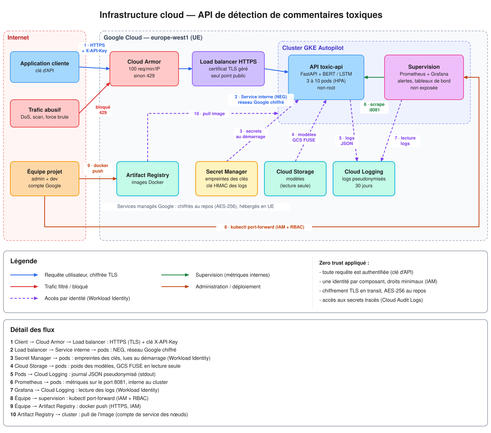

# Digital Social Score — détection de commentaires toxiques

API d'IA qui indique si un commentaire est toxique, entraînée sur des données **anonymisées par NER**, déployée sur **Google Cloud (GKE Autopilot)** avec authentification, protection contre les abus, supervision Prometheus / Grafana, tests de charge et pipeline DevSecOps.

> ### API en ligne : **http://136.82.246.21**
>
> ```bash
> curl http://136.82.246.21/health
> curl -X POST http://136.82.246.21/model -H "Content-Type: application/json" \
>      -H "X-API-Key: <clé>" -d '{"text": "You are an idiot"}'
> # {"is_toxic": true}
> ```
>
> Une clé d'API est nécessaire pour `/model` (à demander à l'équipe). Pour déployer votre propre instance : [§8](#8-déploiement-sur-google-cloud).

| | |
|---|---|
| **Modèle servi** | DistilBERT affiné (ROC-AUC moyenne 0,985 sur 6 classes), BiLSTM en option rapide |
| **Données** | Jigsaw Toxic Comment (Wikipedia), 159 571 commentaires d'entraînement, pseudonymisés avant entraînement |
| **Hébergement** | GKE Autopilot, région UE (`europe-west1`), 3 à 15 pods, load balancer + Cloud Armor |
| **Livrables** | TP1 : [livrables_tp1/](livrables_tp1/) · TP2 (attaque, défense, IA Act, DevSecOps) : [livrable_tp2/](livrable_tp2/) |

## Sommaire

1. [Architecture](#1-architecture)
2. [Organisation du code](#2-organisation-du-code)
3. [Prérequis](#3-prérequis)
4. [Démarrage rapide en local](#4-démarrage-rapide-en-local-10-min-sans-cloud)
5. [Données, anonymisation et modèles](#5-données-anonymisation-et-modèles)
6. [L'API](#6-lapi)
7. [Sécurité et RGPD](#7-sécurité-et-rgpd)
8. [Déploiement sur Google Cloud](#8-déploiement-sur-google-cloud)
9. [Supervision et observabilité](#9-supervision-et-observabilité)
10. [Tests de charge](#10-tests-de-charge)
11. [Attaque et défense (TP2)](#11-attaque-et-défense-tp2)
12. [Pipeline CI/CD DevSecOps](#12-pipeline-cicd-devsecops)
13. [Choix techniques et alternatives](#13-choix-techniques-et-alternatives)
14. [Résultats clés et pistes d'amélioration](#14-résultats-clés-et-pistes-damélioration)
15. [Coûts, arrêt et suppression](#15-coûts-arrêt-et-suppression)
16. [Dépannage](#16-dépannage)

---

## 1. Architecture



Un client envoie un texte en HTTP au **load balancer Google**, où **Cloud Armor** filtre les abus (débit par IP, ban, taille des requêtes). Le load balancer route vers les **pods de l'API** (FastAPI + PyTorch CPU), qui vérifient la clé d'API, appliquent leurs propres limites et renvoient la décision du modèle. Les poids des modèles sont lus depuis **Cloud Storage** (lecture seule), les secrets depuis **Secret Manager** (Workload Identity, sans clé stockée dans le cluster), les journaux pseudonymisés partent vers **Cloud Logging**, et **Prometheus / Grafana** supervisent le tout depuis un namespace non exposé.

Description complète (flux numérotés, chiffrement, IAM, zero trust, légende) : [docs/architecture/ARCHITECTURE_CLOUD.md](docs/architecture/ARCHITECTURE_CLOUD.md). Source éditable du schéma : [architecture-cloud.excalidraw](docs/architecture/architecture-cloud.excalidraw).

## 2. Organisation du code

```
├── api.py                    API FastAPI : /model (inférence), /health ; défenses (voir §7)
├── train.py · evaluate.py    entraînement, évaluation sur le jeu de test
├── compare.py · predict.py   comparaison des modèles, score d'un texte en ligne de commande
├── count_entities.py         repérage des données personnelles (spaCy + regex)
├── anonymize.py              pseudonymisation par NER + regex
├── clean_text.py             nettoyage après anonymisation
├── make_api_key.py           génération d'une clé d'API et de son empreinte
├── toxicity/                 bibliothèque du projet
│   ├── models/               BERT, LSTM, LAYA (interface commune ToxicityModel, registre)
│   ├── data.py · config.py   chargement des jeux de données, paramètres
│   ├── audit_log.py          journal d'accès JSON pseudonymisé (HMAC)
│   ├── metrics_prom.py       métriques Prometheus
│   └── body_limit.py · ip_limit.py · fair_queue.py   défenses anti-abus de l'API
├── k8s/                      manifeste GKE, script Cloud Armor, supervision (k8s/monitoring/)
├── loadtest/                 tests de charge Locust (scénarios dans config.toml)
├── attack/                   attaque DoS, banc avant / après défense, analyses (TP2)
├── tests/ · ci/              tests pytest des défenses, contrôle de la model card
├── .github/workflows/        pipeline DevSecOps
├── data/                     jeu Jigsaw brut, anonymisé et nettoyé (versionné)
├── docs/architecture/        schéma et description de l'infrastructure
├── model_card.json           fiche du modèle (IA Act)
├── REGISTRE_TRAITEMENT.md    registre RGPD (article 30)
└── API.md                    documentation de l'API
```

Chaque modèle implémente la même interface (`fit`, `predict_proba`, `save`, `load`) : `train.py`, `evaluate.py`, `predict.py` et l'API fonctionnent avec n'importe lequel. Ajouter un modèle : créer `toxicity/models/<nom>.py` (classe héritant de `ToxicityModel`), l'enregistrer dans `toxicity/models/registry.py`, puis `train.py --model <nom>`.

## 3. Prérequis

| Outil | Pour quoi | Installation |
|---|---|---|
| **git** | Récupérer le projet | — |
| **uv** ≥ 0.10 | Python 3.12 et toutes les dépendances, versions figées par `uv.lock` | [docs.astral.sh/uv](https://docs.astral.sh/uv/getting-started/installation/) |
| Docker | Construire l'image (déploiement) | [docker.com](https://www.docker.com/) ; ou Cloud Build, sans Docker local |
| Google Cloud SDK (`gcloud`) + `kubectl` | Déploiement sur GCP | [cloud.google.com/sdk](https://cloud.google.com/sdk/docs/install), puis `gcloud components install kubectl` |
| Un projet GCP avec facturation | Déploiement | Rôle Owner (ou Editor + Security Admin) sur le projet |

Python n'a pas à être installé : `uv` télécharge la bonne version. PyTorch est choisi automatiquement selon la machine : CUDA 13.0 sur Windows (GPU NVIDIA), CPU sur Linux, MPS sur Mac (voir `[tool.uv.sources]` dans [pyproject.toml](pyproject.toml)).

## 4. Démarrage rapide en local (~10 min, sans cloud)

```bash
git clone https://github.com/TitouanRobe/IA_toxic_comments_detector.git
cd IA_toxic_comments_detector
uv sync                          # dépendances (API + entraînement + outils de dev)
uv run pytest                    # tests des défenses de l'API (sans modèle, ~5 s)

# Un modèle de démonstration (quelques minutes sur CPU ; entraînement complet : §5)
uv run python train.py --model bert --limit 2000 --epochs 1 --max-length 128 --test-limit 1000
uv run python predict.py --model bert "You are an idiot" "Thanks for your help"

# Lancer l'API avec une clé d'API
uv run python make_api_key.py    # affiche une clé (pour le client) et son empreinte (pour l'API)
ENABLE_DOCS=1 API_KEY_HASHES=<empreinte> uv run uvicorn api:app --port 8000
```

Dans un second terminal :

```bash
curl http://127.0.0.1:8000/health
curl -X POST http://127.0.0.1:8000/model -H "Content-Type: application/json" \
     -H "X-API-Key: <clé>" -d '{"text": "You are an idiot"}'
```

Documentation interactive : http://127.0.0.1:8000/docs (bouton **Authorize** pour la clé ; uniquement avec `ENABLE_DOCS=1`). Sous Windows (PowerShell), définir les variables avant la commande : `$env:API_KEY_HASHES="<empreinte>"; $env:ENABLE_DOCS="1"`.

## 5. Données, anonymisation et modèles

Les fichiers du jeu [Jigsaw Toxic Comment Classification](https://www.kaggle.com/c/jigsaw-toxic-comment-classification-challenge) sont versionnés dans `data/`, avec leurs versions anonymisées et nettoyées : toutes les étapes ci-dessous peuvent être sautées pour aller directement à l'entraînement. Chaque script ne recalcule pas un résultat déjà présent (option `--force` pour `anonymize.py`).

| Étape | Commande | Entrée → sortie |
|---|---|---|
| 1. Repérer les données personnelles | `uv run python count_entities.py` | `train.csv` → `train_entities.csv`, `train_entities_totals.csv` |
| 2. Pseudonymiser (NER spaCy + regex) | `uv run python anonymize.py --split train` puis `--split test` | `<split>.csv` → `<split>_anonymized.csv` |
| 3. Nettoyer (casse, ponctuation, emojis) | `uv run python clean_text.py --split train` puis `--split test` | `<split>_anonymized.csv` → `<split>_clean.csv` |
| 4. Entraîner | `uv run python train.py --model bert` (GPU conseillé) · `--model lstm --epochs 5` · `--model laya --epochs 2` | `train_clean.csv` → `artifacts/<modèle>/`, `results/<modèle>/metrics.json` |
| 5. Évaluer sur le test anonymisé | `uv run python evaluate.py --limit 5000` | `artifacts/` + `test_clean.csv` → `results/<modèle>/metrics_test_clean.json` |
| 6. Comparer | `uv run python compare.py` | tableau ROC-AUC, précision, rappel, F1, temps |

**Anonymisation.** Personnes, lieux précis, emails, URL, IP, téléphones, IBAN, cartes, adresses et pseudonymes `User:` sont remplacés par des pseudonymes typés et numérotés par commentaire (`[PERSON_1]`) ; nationalités, groupes et organisations sont conservés car ils portent le signal de la classe `identity_hate`. Les regex sont relancées sur le texte anonymisé pour détecter des fuites résiduelles. 40 % des commentaires d'entraînement sont modifiés. Détail et justification : [livrables_tp1/01_donnees/ANONYMISATION.md](livrables_tp1/01_donnees/ANONYMISATION.md).

**Modèles.** Trois architectures comparées sur 5 000 commentaires du test anonymisé ([livrables_tp1/02_modeles/COMPARAISON_MODELES.md](livrables_tp1/02_modeles/COMPARAISON_MODELES.md)) :

| Modèle | ROC-AUC moyenne | Temps par commentaire | En production |
|---|---|---|---|
| **BERT** (DistilBERT affiné) | **0,985** | ~30 ms | **Oui, par défaut** : meilleur compromis qualité / coût |
| LSTM (BiLSTM entraîné de zéro) | 0,976 | ~1-2 ms | Oui, `"model": "lstm"`, repli rapide |
| LAYA (ModernBERT-large) | 0,985 | > 10 × BERT | Non : ~3 Go de mémoire par pod pour aucun gain de ROC-AUC |

## 6. L'API

| Endpoint | Rôle | Authentification |
|---|---|---|
| `POST /model` | `{"text": "...", "model": "bert"}` → `{"is_toxic": true}` (classe `toxic` > 70 %) | Clé `X-API-Key` |
| `GET /health` | État et modèles chargés (sondes Kubernetes, load balancer) | Publique |

Seule la décision est renvoyée : les scores restent côté serveur (journal, métriques), pour ne pas permettre de copier le modèle. Codes d'erreur, exemples et limites : [API.md](API.md).

Principales variables d'environnement (liste complète en tête de [api.py](api.py)) :

| Variable | Défaut | Rôle |
|---|---|---|
| `API_KEY_HASHES` / `API_KEY_HASHES_FILE` | — | Empreintes SHA-256 des clés acceptées (sans clé, l'API refuse de démarrer) |
| `LOG_PSEUDONYM_KEY` / `_FILE` | aléatoire | Clé HMAC de pseudonymisation des journaux |
| `PRELOAD_MODELS` · `ALLOWED_MODELS` | `bert` · tous | Modèles chargés et préchauffés au démarrage · modèles servis |
| `MAX_QUEUE_LENGTH` · `INFERENCE_QUEUE_TIMEOUT` | `8` · `2` s | Délestage : file d'attente par pod, attente maximale avant `503` |
| `MAX_IN_FLIGHT_PER_IP` | `4` | Requêtes simultanées par IP et par pod avant `429` (`0` pour désactiver) |
| `ENABLE_DOCS` · `AUTH_DISABLED` | désactivés | `/docs` · authentification désactivée (local uniquement) |

## 7. Sécurité et RGPD

| Exigence | Mise en œuvre | Détail |
|---|---|---|
| **Anonymisation / pseudonymisation** | NER spaCy + regex avant entraînement ; journaux pseudonymisés par HMAC-SHA256 (client, IP) | §5, [toxicity/audit_log.py](toxicity/audit_log.py) |
| **Minimisation** | Texte analysé jamais stocké ni journalisé ; IP jamais en clair ; journaux conservés 30 jours | [REGISTRE_TRAITEMENT.md](REGISTRE_TRAITEMENT.md) |
| **Authentification** | Clé d'API de 256 bits ; seule son empreinte est stockée (Secret Manager) ; comparaison en temps constant ; échec fermé | [livrables_tp1/04_securite_rgpd/SECURITE.md](livrables_tp1/04_securite_rgpd/SECURITE.md) |
| **IAM** | Workload Identity : une identité par composant, droits minimaux (l'API lit 2 secrets et 1 bucket, rien d'autre) ; aucune clé de compte de service | [ARCHITECTURE_CLOUD.md §4](docs/architecture/ARCHITECTURE_CLOUD.md) |
| **Chiffrement** | Au repos : Secret Manager, Cloud Storage, Artifact Registry, Cloud Logging (AES-256, Google). En transit : réseau Google entre load balancer et pods | [ARCHITECTURE_CLOUD.md](docs/architecture/ARCHITECTURE_CLOUD.md) |
| **Protection contre les abus** | Cloud Armor (100 req/min par IP, ban 10 min au-delà de 200, corps > 4 Ko rejetés) ; dans l'API : plafond par IP, file équitable, délestage rapide, limites de taille, en-têtes de sécurité, docs fermées | [livrable_tp2/3_defense.md](livrable_tp2/3_defense.md) |
| **Conteneurs** | Non-root, système de fichiers en lecture seule, capabilities retirées, modèles montés en lecture seule | [k8s/toxic-api.yaml](k8s/toxic-api.yaml) |
| **Conformité** | Registre RGPD (art. 30), hébergement UE, fiche IA Act (risque minimal), model card vérifiée par la CI | [REGISTRE_TRAITEMENT.md](REGISTRE_TRAITEMENT.md), [livrable_tp2/4_fiche_ia_act.md](livrable_tp2/4_fiche_ia_act.md), [model_card.json](model_card.json) |

## 8. Déploiement sur Google Cloud

Toutes les commandes sont paramétrées par [deploy.env.example](deploy.env.example) : rien n'est propre à notre projet. Elles s'exécutent dans un terminal bash (Linux, Mac, Git Bash ou Cloud Shell), depuis la racine du dépôt. Prévoir **~30 min** la première fois.

**8.1 Configuration (une fois)**

```bash
gcloud auth login
cp deploy.env.example deploy.env      # puis éditer PROJECT (et REGION)
source deploy.env                     # à refaire dans chaque nouveau terminal
gcloud services enable container.googleapis.com artifactregistry.googleapis.com \
  compute.googleapis.com secretmanager.googleapis.com
```

**8.2 Infrastructure (une fois)**

```bash
# Registre d'images, cluster Autopilot (5 à 10 min), IP publique
gcloud artifacts repositories create toxic --repository-format=docker --location=$REGION
gcloud container clusters create-auto $CLUSTER --region $REGION
gcloud container clusters update $CLUSTER --region $REGION --enable-secret-manager
gcloud container clusters get-credentials $CLUSTER --region $REGION
gcloud compute addresses create toxic-api-ip --global
source deploy.env && echo "API : http://$DOMAIN"     # recalcule IP et DOMAIN

# Cloud Armor : politique "toxic-api-policy" (script relançable)
bash k8s/cloud-armor-setup.sh

# Secrets : empreinte de la clé d'API (noter la CLÉ affichée, elle n'est montrée qu'une fois)
# et clé de pseudonymisation des journaux, stockées dans la région choisie
uv run python make_api_key.py
printf '%s' "<empreinte>" | gcloud secrets create toxic-api-keys \
  --replication-policy=user-managed --locations=$REGION --data-file=-
openssl rand -hex 32 | tr -d '\n' | gcloud secrets create toxic-api-log-key \
  --replication-policy=user-managed --locations=$REGION --data-file=-

# Modèles : bucket privé en UE ; artifacts/ doit contenir les modèles entraînés (§5)
gcloud storage buckets create gs://$PROJECT-toxic-models --location=$REGION \
  --uniform-bucket-level-access --public-access-prevention
gcloud storage cp -r artifacts/bert artifacts/lstm gs://$PROJECT-toxic-models/

# IAM : seul le compte de service Kubernetes de l'API lit ces secrets et ce bucket
for SECRET in toxic-api-keys toxic-api-log-key; do
  gcloud secrets add-iam-policy-binding $SECRET --role=roles/secretmanager.secretAccessor \
    --member="$WI/default/sa/toxic-api"
done
gcloud storage buckets add-iam-policy-binding gs://$PROJECT-toxic-models \
  --role=roles/storage.objectViewer --member="$WI/default/sa/toxic-api"
```

**8.3 Image et déploiement (à chaque nouvelle version)**

```bash
source deploy.env
TAG=$(date +%Y%m%d-%H%M)              # tag unique : ne jamais réutiliser un tag
gcloud auth configure-docker $REGION-docker.pkg.dev
docker build --platform linux/amd64 -t $REPO/toxic-api:$TAG . && docker push $REPO/toxic-api:$TAG
#   sans Docker : gcloud builds submit --tag $REPO/toxic-api:$TAG

: "${REGION:?}" "${PROJECT:?}" "${DOMAIN:?}" "${TAG:?}"   # s'arrête si une variable est vide
sed -e "s/REGION/$REGION/" -e "s/PROJECT_ID/$PROJECT/" -e "s/DOMAIN/$DOMAIN/" -e "s/IMAGE_TAG/$TAG/" \
  k8s/toxic-api.yaml | kubectl apply -f -
kubectl rollout status deployment/toxic-api
```

**8.4 Vérification**

```bash
kubectl get pods,hpa -l app=toxic-api           # 3 pods Running
curl http://$DOMAIN/health                       # {"status":"ok",...} (load balancer prêt en ~5 min)
curl -X POST http://$DOMAIN/model -H "Content-Type: application/json" \
  -H "X-API-Key: <clé>" -d '{"text": "You are an idiot"}'
curl -s -o /dev/null -w "%{http_code}\n" http://$DOMAIN/docs     # 404 : docs fermées
```

**8.5 Opérations courantes**

| Besoin | Commande |
|---|---|
| Nouvelle version | §8.3 avec un nouveau `TAG` (le changement de tag déclenche le déploiement progressif) |
| Retour arrière | §8.3 avec l'ancien `TAG` (tag en cours : `kubectl get deploy toxic-api -o jsonpath='{.spec.template.spec.containers[0].image}'`) |
| Mettre à jour un modèle | `gcloud storage cp -r artifacts/bert gs://$PROJECT-toxic-models/` puis `kubectl rollout restart deployment/toxic-api` |
| Ajouter ou changer une clé sans coupure | `printf '%s\n%s' "$EMPREINTE1" "$EMPREINTE2" \| gcloud secrets versions add toxic-api-keys --data-file=-` puis `kubectl rollout restart deployment/toxic-api` |
| Journaux | `kubectl logs deploy/toxic-api` ou Cloud Logging, filtre `resource.labels.container_name="toxic-api"` |
| Autoscaling | `kubectl get hpa toxic-api` |

## 9. Supervision et observabilité

**Installation** (après le §8) :

```bash
source deploy.env
kubectl create namespace monitoring
kubectl -n monitoring create secret generic grafana-admin --from-literal=password="$(openssl rand -base64 18)"
gcloud projects add-iam-policy-binding $PROJECT --role=roles/logging.viewer --condition=None \
  --member="$WI/monitoring/sa/grafana"           # Grafana lit les journaux (lecture seule)
kubectl kustomize k8s/monitoring | sed "s/PROJECT_ID/$PROJECT/" | kubectl apply -f -
kubectl -n monitoring rollout status deployment/prometheus deployment/grafana
```

**Accès** (namespace non exposé sur Internet, uniquement par tunnel authentifié) :

```bash
kubectl -n monitoring port-forward svc/grafana 3000:3000      # http://localhost:3000, utilisateur admin
kubectl -n monitoring get secret grafana-admin -o jsonpath='{.data.password}' | base64 -d
kubectl -n monitoring port-forward svc/prometheus 9090:9090   # http://localhost:9090/alerts
```

**Métriques exposées** par l'API ([toxicity/metrics_prom.py](toxicity/metrics_prom.py), port 8081 interne au cluster, sans donnée personnelle, labels bornés) :

| Métrique | Question à laquelle elle répond |
|---|---|
| `toxic_api_requests_total{status}` | Combien de requêtes, avec quel résultat (200, 401, 429, 503…) ? |
| `toxic_api_request_duration_seconds` | Quelle latence voit le client (P50 / P95 / P99) ? |
| `toxic_api_inference_duration_seconds` vs `toxic_api_queue_wait_seconds` | Le temps est-il passé dans le modèle ou à attendre son tour ? (distingue « modèle lent » de « pod saturé ») |
| `toxic_api_queue_waiting` | Combien de requêtes attendent, par pod ? (indicateur de saturation plus précoce que le CPU) |
| `toxic_api_shed_total{reason}` | Les refus visent-ils l'attaquant (`ip_limit`, `evicted`) ou tout le monde (`full`, `timeout`) ? |
| `toxic_api_toxicity_score` · `toxic_api_text_length_chars` | Dérive des données ou abus (part de textes toxiques, textes anormalement longs) |
| CPU, mémoire du processus | Saturation, fuite mémoire |

**Tableau de bord Grafana** « Toxic API - supervision » ([dashboard-toxic-api.json](k8s/monitoring/dashboard-toxic-api.json)), 4 sections : vue d'ensemble (débit, P95, erreurs, pods, échecs d'authentification, alertes), trafic et latence (dont inférence vs attente), ressources des pods, sécurité et comportement anormal. Les journaux pseudonymisés de Cloud Logging sont consultables dans **Explore**.

**Alertes** ([alert-rules.yml](k8s/monitoring/alert-rules.yml)) : SLO de latence (95 % < 1 s), taux de 5xx, délestage, CPU / mémoire, pods manquants, pic d'échecs d'authentification (force brute), scan d'URL, anomalie de la part de textes toxiques. Analyse et captures : [livrables_tp1/06_supervision_securite/SUPERVISION.md](livrables_tp1/06_supervision_securite/SUPERVISION.md).

## 10. Tests de charge

Locust, scénarios décrits dans [loadtest/config.toml](loadtest/config.toml) (modifiables sans toucher au code). Chaque scénario relève aussi le nombre de pods et le CPU toutes les 15 s, pour suivre l'autoscaling.

| Scénario | Profil | Ce qu'il vérifie |
|---|---|---|
| `smoke` | 2 utilisateurs, 30 s | Clé, URL et Cloud Armor avant un vrai test |
| `ramp` | 5 → 120 utilisateurs par paliers | Point de saturation, réaction de l'autoscaling |
| `rapid` | 0 → 120 en 12 s | Délai de réaction de l'autoscaling à un pic brutal |
| `soak` | 60 utilisateurs, 30 min | Stabilité de la latence et de la mémoire dans la durée |
| `failover` | 40 utilisateurs, **un pod supprimé à 5 min** | Reprise après panne |
| `stress` | 0 → 200 en 1 min | Comportement au-delà de la capacité |
| `spike` | 10 → 150 → 10 | Montée puis descente du nombre de pods |

```bash
source deploy.env
printf '%s' "dss_..." > loadtest/.api_key       # clé de test (fichier ignoré par git)
# Lever les protections anti-abus pour la machine de test, le temps du test
gcloud compute security-policies rules create 950 --security-policy toxic-api-policy \
  --src-ip-ranges "$(curl -s https://ifconfig.me)/32" --action allow --description "test de charge"
kubectl set env deployment/toxic-api MAX_IN_FLIGHT_PER_IP=0

uv run python loadtest/run.py smoke --host http://$DOMAIN
uv run python loadtest/run.py ramp --host http://$DOMAIN     # puis rapid, soak, failover, stress, spike
uv run python loadtest/summarize.py                           # tableau de tous les tests

# Rétablir les protections
gcloud compute security-policies rules delete 950 --security-policy toxic-api-policy --quiet
kubectl set env deployment/toxic-api MAX_IN_FLIGHT_PER_IP=4
```

Résultats dans `loadtest/results/` (statistiques CSV, rapports HTML Locust, relevés de l'autoscaling). Analyse : [livrables_tp1/05_charge/RAPPORT_CHARGE.md](livrables_tp1/05_charge/RAPPORT_CHARGE.md). Mode interactif : `uv run locust -f loadtest/locustfile.py` puis http://localhost:8089.

## 11. Attaque et défense (TP2)

Attaque par déni de service sur l'endpoint d'inférence, menée contre un autre groupe et subie de la part d'un groupe et du professeur ; défenses en couches mesurées avant / après. Tout est dans [livrable_tp2/](livrable_tp2/) ; code et analyses dans [attack/](attack/).

```bash
uv run python attack/dos.py http://<cible> --endpoint /health --duration 30 --concurrency 100   # tir borné
uv run python attack/bench_defense.py run --ref 451d731 --label avant   # version attaquée (~5 min)
uv run python attack/bench_defense.py run --label apres                  # version défendue (~5 min)
uv run python attack/bench_defense.py report                             # tableau + graphiques
```

Le banc lance l'API en local dans les deux versions et mesure, pendant l'attaque, la précision, le taux de faux positifs et la latence vécus par des clients légitimes. Il nécessite `artifacts/bert/` (§5).

## 12. Pipeline CI/CD DevSecOps

[.github/workflows/devsecops.yml](.github/workflows/devsecops.yml) s'exécute à chaque push sur `main` et chaque pull request ; un seul échec bloque la fusion. Droits en lecture seule, outils à version fixée.

| Job | Contrôle |
|---|---|
| `gitleaks` | Secrets dans le code et tout l'historique git |
| `pip-audit` | Dépendances vulnérables (versions exactes de `uv.lock`) |
| `bandit` · `ruff` | Failles et bugs probables dans le code Python |
| `hadolint` · `trivy-image` | Bonnes pratiques du Dockerfile · failles HIGH/CRITICAL de l'image construite |
| `kubeconform` · `kube-linter` | Validité et sécurité du manifeste Kubernetes |
| `tests` | Tests des défenses de l'API ([tests/](tests/)) |
| `model-card` | Conformité IA Act de `model_card.json` ([ci/check_model_card.py](ci/check_model_card.py)) |

Rejouer en local les contrôles qui ne demandent pas Docker (un log par contrôle) : `bash ci/local_checks.sh`. Détail et problèmes trouvés par la pipeline : [livrable_tp2/5_devsecops.md](livrable_tp2/5_devsecops.md).

## 13. Choix techniques et alternatives

| Choix | Alternatives | Pourquoi ce choix |
|---|---|---|
| **GKE Autopilot** | Cloud Run, GKE Standard, VM | Autoscaling horizontal fin, volumes partagés pour les modèles, Cloud Armor via l'Ingress, Prometheus dans le cluster ; Autopilot facture les pods et non les nœuds, et gère les mises à jour. Cloud Run aurait été plus simple, mais limite le contrôle (file d'attente, sondes, supervision) |
| **DistilBERT** servi par défaut | LSTM, LAYA (ModernBERT-large) | Les trois ont été entraînés et comparés (§5) : BERT a la meilleure ROC-AUC à un coût acceptable sur CPU ; LAYA n'apporte rien de plus pour 3 Go de mémoire par pod |
| **Inférence sur CPU** | GPU | ~8 requêtes/s par pod suffisent à la charge visée ; un nœud GPU coûte beaucoup plus cher en permanence |
| **Poids dans Cloud Storage** (lecture seule) | Poids dans l'image | Image légère (build et push rapides), modèle mis à jour sans reconstruire l'image, partagé par tous les pods quel que soit le nœud |
| **spaCy + regex** pour l'anonymisation | Presidio, modèles NER plus gros | spaCy repère les noms ; les regex sont exactes sur les formats structurés (IP, email, téléphone) que le NER rate. Léger et rapide sur 300 000 commentaires |
| **Clé d'API + empreinte** dans Secret Manager | OAuth 2 / JWT, IAM Google | Simple pour quelques applications clientes, révocable par client, rien d'exploitable en cas de fuite du secret. JWT recommandé au-delà de quelques clients |
| **HMAC** pour pseudonymiser les journaux | Hachage simple, suppression des IP | Un hachage simple d'IP se retrouve par force brute (4 milliards de valeurs) ; le HMAC à clé secrète ne le permet pas, tout en gardant la possibilité de suivre une IP abusive |
| **Prometheus + Grafana** dans le cluster | Cloud Monitoring, Managed Prometheus | Métriques métier sur mesure (attente en file, délestage), tableau de bord et alertes versionnés dans git, aucun coût d'ingestion |
| **Locust** | k6, JMeter | Scénarios écrits en Python comme le reste du projet, paliers et failover pilotés par un fichier de configuration |
| **uv** | pip, Poetry, conda | Installation rapide, `uv.lock` reproductible, index PyTorch différent selon la plateforme (CUDA, CPU, MPS) |
| **Défense en couches** contre les abus | Cloud Armor seul | Mesuré : Cloud Armor a arrêté un groupe, mais pas l'attaque du professeur passée sous ses seuils. L'API doit aussi refuser vite et équitablement ([livrable_tp2/3_defense.md](livrable_tp2/3_defense.md)) |

## 14. Résultats clés et pistes d'amélioration

| Domaine | Résultat |
|---|---|
| Qualité du modèle | ROC-AUC moyenne 0,985 (BERT) sur le test anonymisé ; au seuil 70 de l'API : précision 88 %, faux positifs 13 % (échantillon équilibré) |
| Anonymisation | 40 % des commentaires d'entraînement pseudonymisés (35 % du test) ; regex relancées après coup pour détecter les fuites ; résultat pseudonymisé, pas anonyme au sens strict (noms mal reconnus possibles) |
| Charge | 70 000 requêtes en 30 min sans erreur (`soak`) ; perte d'un pod sans erreur visible (`failover`) ; ≤ 0,03 % d'erreurs en stress |
| Résistance aux abus | Sous flood depuis une IP, latence médiane des clients légitimes 1 001 → 81 ms après les défenses du TP2 |

Limites connues et améliorations proposées :
- **Latence au-delà de ~40 requêtes/s** (6 pods) : autoscaling sur la longueur de file plutôt que sur le CPU, modèle plus léger (ONNX, quantification) ou inférence par lots ([RAPPORT_CHARGE.md §4](livrables_tp1/05_charge/RAPPORT_CHARGE.md)).
- **Biais** : le modèle sur-signale les textes mentionnant certaines minorités ; relecture humaine obligatoire, jeu d'évaluation dédié à prévoir ([model_card.json](model_card.json)).
- **Attaque très distribuée** : les défenses par IP limitent les dégâts sans les supprimer ; une clé par client et plus de capacité prête à l'avance ([livrable_tp2/6_analyse_critique.md](livrable_tp2/6_analyse_critique.md)).
- **Déploiement continu** : la pipeline vérifie mais ne déploie pas encore.

## 15. Coûts, arrêt et suppression

Ce qui coûte en continu : le cluster (~0,10 $/h de frais de gestion Autopilot, plus 2 CPU et 2 Go par pod), l'IP réservée, la politique Cloud Armor et le load balancer.

```bash
source deploy.env
# Suspendre (garde la configuration ; le cluster et le load balancer restent facturés)
kubectl delete hpa toxic-api && kubectl scale deployment/toxic-api --replicas=0
kubectl -n monitoring scale deployment/grafana deployment/prometheus --replicas=0
# Reprendre : refaire le §8.3 avec le TAG en cours (recrée l'autoscaling), puis :
kubectl scale deployment/toxic-api --replicas=3
kubectl -n monitoring scale deployment/grafana deployment/prometheus --replicas=1

# Tout supprimer (irréversible). D'abord l'Ingress, pour que GKE supprime le load balancer :
# supprimer directement le cluster peut laisser des règles de load balancer orphelines (facturées).
kubectl delete ingress toxic-api --wait
gcloud compute forwarding-rules list            # attendre que la liste soit vide
gcloud container clusters delete $CLUSTER --region $REGION --quiet
gcloud compute addresses delete toxic-api-ip --global --quiet
gcloud compute security-policies delete toxic-api-policy --quiet
gcloud artifacts repositories delete toxic --location $REGION --quiet
gcloud secrets delete toxic-api-keys --quiet && gcloud secrets delete toxic-api-log-key --quiet
gcloud storage rm -r gs://$PROJECT-toxic-models
```

La politique Cloud Armor ne peut être supprimée qu'une fois le load balancer supprimé (elle lui est attachée). Vérifier ensuite dans la console **Facturation → Rapports** que les coûts retombent à zéro (délai d'affichage d'environ 24 h).

## 16. Dépannage

| Symptôme | Cause et solution |
|---|---|
| `RuntimeError: Aucune clé d'API` au démarrage | Définir `API_KEY_HASHES` (empreinte, pas la clé) ou `AUTH_DISABLED=1` en local |
| `422` sur `/model` | Texte vide ou de plus de 1 500 caractères |
| `429` pendant un test de charge | Limites anti-abus actives : voir §10 (exception Cloud Armor, `MAX_IN_FLIGHT_PER_IP=0`) |
| Pods en `Pending` | Quota de CPU de la région atteint (chaque pod réserve 2 CPU) : réduire `maxReplicas` ou demander une hausse de quota |
| Pod en `CrashLoopBackOff` | `kubectl logs deploy/toxic-api` : secret absent ou droit IAM manquant (§8.2), modèle absent du bucket |
| `exec format error` sur GKE | Image construite sur Mac ARM sans `--platform linux/amd64` |
| Pas de GPU détecté sous Windows | `uv run python -c "import torch; print(torch.cuda.is_available())"` ; pilote NVIDIA compatible CUDA 13 requis |

---

**Équipe :** Cléo Martin-Colleu, Titouan Robe — ESIGELEC, Déploiement de solutions IA et cybersécurité.
