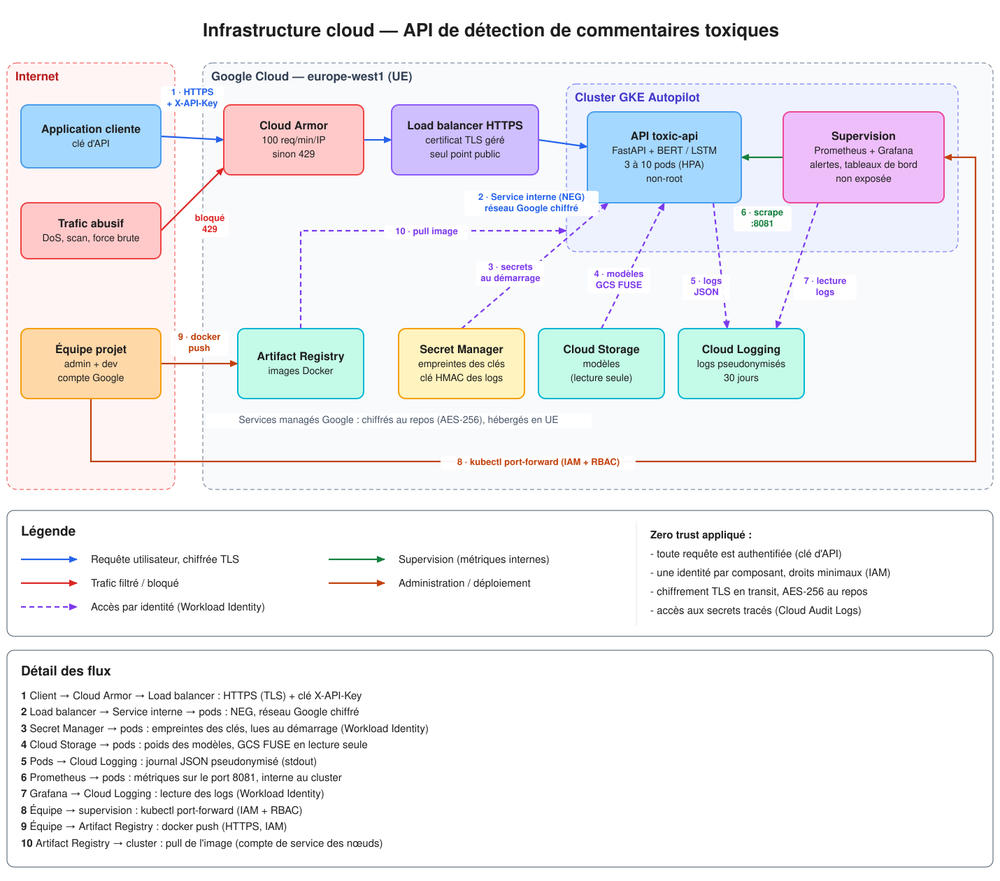

# Modélisation de l'infrastructure cloud — Digital Social Score

API de détection de commentaires toxiques déployée sur Google Cloud (GKE Autopilot, région `europe-west1`), conçue selon une approche **zero trust** : aucun composant n'est considéré comme fiable du seul fait de sa position dans le réseau. Chaque accès est authentifié, autorisé au plus juste, chiffré et tracé.

## 1. Schéma d'architecture

> Source éditable : [architecture-cloud.excalidraw](architecture-cloud.excalidraw). L'ouvrir sur [excalidraw.com](https://excalidraw.com) (menu *Ouvrir*) ou avec l'extension VS Code *Excalidraw*, puis réexporter le SVG après modification.

## 2. Légende du schéma

### Zones (cadres en pointillés)

| Zone | Signification | Niveau de confiance |
|---|---|---|
| **Internet** (rouge) | Clients, attaquants potentiels, postes de l'équipe | Aucun : tout ce qui en vient est filtré et authentifié |
| **Projet Google Cloud — europe-west1** (gris) | Ressources hébergées dans l'UE (RGPD : pas de transfert hors UE) | Périmètre administratif, pas une zone de confiance |
| **Cluster GKE Autopilot** (bleu) | Nœuds de calcul gérés par Google (mises à jour, durcissement). L'API tourne dans le namespace `default`, la supervision dans le namespace `monitoring` | Les pods ne se font pas confiance entre eux ; seule l'API est atteignable depuis le load balancer |

La rangée du bas regroupe les **services managés Google** utilisés par le cluster. Ils sont tous chiffrés au repos (AES-256) et hébergés dans l'UE.

### Composants (boîtes)

| Couleur | Type | Composants |
|---|---|---|
| Rouge | Sécurité périmétrique / menace | Trafic abusif, Cloud Armor |
| Violet | Point d'entrée | Load balancer HTTPS (Ingress) |
| Bleu | Calcul / IA | Application cliente, API `toxic-api` |
| Rose | Supervision | Prometheus + Grafana |
| Jaune | Secrets | Secret Manager |
| Turquoise | Stockage | Cloud Storage, Cloud Logging, Artifact Registry |
| Orange | Acteurs humains | Équipe projet (administration et développement) |

Le cadre « Zero trust appliqué » de la légende résume les règles valables pour tout le schéma : authentification de chaque requête, une identité IAM par composant avec droits minimaux, chiffrement partout, traçabilité des accès aux secrets.

### Flux (flèches)

| Style | Signification |
|---|---|
| Bleu plein | Requête utilisateur, chiffrée en TLS |
| Rouge plein | Trafic filtré ou bloqué (réponse `429`) |
| Violet pointillé | Accès d'un composant à un service Google, authentifié par son identité (Workload Identity / IAM) |
| Vert plein | Supervision : collecte et lecture de métriques internes |
| Orange plein | Administration et déploiement par l'équipe |

### Détail des flux numérotés

| # | De → vers | Protocole / chiffrement | Authentification / autorisation |
|---|---|---|---|
| 1 | Application cliente → Load balancer | HTTPS (TLS, certificat géré par Google), HSTS 1 an | Clé d'API dans l'en-tête `X-API-Key` (vérifiée en 4) ; Cloud Armor limite à 100 req/min/IP |
| 2 | Load balancer → Service interne (ClusterIP) → pods de l'API | HTTP dans le réseau Google, chiffré au niveau réseau par Google (NEG : envoi direct aux pods) | Seul le port 8080 est publié par le Service |
| 3 | Secret Manager → Pods | API Google (TLS) via le pilote CSI, au démarrage du pod | Workload Identity : seul le compte de service `toxic-api` a `secretmanager.secretAccessor` ; accès tracés dans Cloud Audit Logs |
| 4 | Cloud Storage → Pods | API Google (TLS) via GCS FUSE, monté en **lecture seule** | Workload Identity : `storage.objectViewer` sur ce seul bucket |
| 5 | Pods → Cloud Logging | Sortie standard collectée par GKE (TLS) | Journal pseudonymisé : IP et client remplacés par un HMAC-SHA256 |
| 6 | Prometheus → pods de l'API (port 8081) | HTTP interne au cluster, port absent du Service et de l'Ingress | RBAC : Prometheus ne peut que lister les pods du namespace `default` |
| 7 | Grafana → Cloud Logging | API Google (TLS) | Workload Identity : `logging.viewer` (lecture seule) |
| 8 | Équipe → supervision (Grafana / Prometheus) | Tunnel `kubectl port-forward` chiffré (TLS vers l'API Kubernetes) | Compte Google + IAM GKE + RBAC ; mot de passe Grafana dans un Secret |
| 9 | Poste de dev → Artifact Registry | HTTPS (`docker push`), `kubectl apply` via l'API GKE | IAM de l'utilisateur ; images à tag unique (pas d'écrasement) |
| 10 | Artifact Registry → nœuds GKE | HTTPS | Compte de service des nœuds, lecture seule |

## 3. Composants et justification

### 3.1 Exposition et filtrage

- **Load balancer HTTPS global (Ingress GKE)** avec IP statique et **certificat TLS géré par Google**. Point d'entrée unique de l'API : le reste du cluster n'a aucune adresse publique. Le certificat se renouvelle tout seul, ce qui supprime le risque d'expiration. L'en-tête HSTS oblige les navigateurs à rester en HTTPS.
- **Cloud Armor** : politique de limitation de débit (100 requêtes par minute et par IP, au-delà `429`). Le trafic abusif (déni de service, force brute sur les clés, scans) est arrêté à la périphérie de Google, avant de consommer du CPU dans les pods. C'est la première barrière contre la menace la plus coûteuse pour une API d'inférence : la saturation du calcul.
- Les **logs du load balancer sont désactivés** parce qu'ils contiennent les IP en clair ; le journal pseudonymisé de l'API les remplace.

### 3.2 API et IA

- **Pods `toxic-api`** (FastAPI + PyTorch CPU) servant les modèles **BERT** et **LSTM**. Chaque pod réserve 2 CPU et 2 Gi. L'inférence est limitée par le CPU, d'où un **HorizontalPodAutoscaler** de 3 à 10 pods (cible 60 % CPU) : 3 pods minimum pour survivre à la perte d'un pod (failover vérifié par les tests de charge), 10 maximum pour plafonner le coût.
- **Durcissement des conteneurs** : utilisateur non-root (UID 1000), `allowPrivilegeEscalation: false`, toutes les capabilities Linux retirées, volumes montés en lecture seule. Si l'API est compromise, l'attaquant ne peut ni devenir root ni modifier les modèles.
- **Authentification applicative** : chaque client reçoit une clé aléatoire de 256 bits. L'API ne stocke que son **empreinte SHA-256** et la compare en temps constant. Une fuite du secret ne donne donc aucune clé utilisable. Sans clé configurée, l'API refuse de démarrer (échec fermé).
- **Protection contre la surcharge** : une inférence à la fois par pod et une file d'attente de 20 s au plus. Au-delà, l'API répond `503` avec `Retry-After` plutôt que de laisser le pod s'effondrer.
- **Service ClusterIP** : adresse interne uniquement, ciblée par le load balancer via les NEG.

### 3.3 Stockage

| Donnée | Service | Justification |
|---|---|---|
| Poids des modèles | **Cloud Storage** (bucket privé, `public-access-prevention`, accès uniforme), monté via GCS FUSE en `ReadOnlyMany` | Partagé par tous les pods, quel que soit le nœud (un disque persistant classique bloquerait l'autoscaling). Mettre à jour un modèle ne demande pas de reconstruire l'image. Lecture seule : un pod compromis ne peut pas empoisonner le modèle |
| Secrets (empreintes des clés, clé HMAC des logs) | **Secret Manager**, répliqué uniquement dans `europe-west1` | Chiffré AES-256, versionné (rotation sans coupure), accès réservé à une seule identité et tracé |
| Images Docker | **Artifact Registry** (région Europe) | Images privées, un tag unique par build (traçabilité, retour arrière en relançant l'ancien tag) |
| Journaux | **Cloud Logging**, conservation 30 jours | Aucun texte analysé ni IP en clair, seulement des pseudonymes |
| Métriques | Disque persistant de Prometheus (10 Gi, 15 jours) | Historique conservé au redémarrage de Prometheus |

**Le texte analysé n'est stocké nulle part** : il reste en mémoire le temps de la requête (`Cache-Control: no-store`). C'est la mesure de minimisation principale du registre RGPD ([REGISTRE_TRAITEMENT.md](../../REGISTRE_TRAITEMENT.md)).

### 3.4 Supervision

- **Prometheus** découvre automatiquement les pods (y compris ceux ajoutés par l'autoscaling), collecte leurs métriques toutes les 10 s sur le port 8081 et évalue les alertes : SLO de latence, taux d'erreurs 5xx, délestage, CPU et mémoire, pods manquants, et alertes de sécurité (`AuthFailureSpike` pour la force brute, `ScanDetected` pour les scans, `ToxicityRatioAnomaly` pour la dérive du modèle ou les abus).
- **Grafana** affiche le tableau de bord et interroge les logs pseudonymisés de Cloud Logging pour analyser un incident.
- Le **port de métriques n'est pas publié** et le namespace `monitoring` n'a aucune exposition publique : l'accès se fait uniquement par `kubectl port-forward`, donc avec un compte Google autorisé sur le cluster.

## 4. Approche zero trust

| Principe zero trust | Mise en œuvre |
|---|---|
| **Ne jamais faire confiance au réseau, toujours vérifier** | Chaque appel à l'API exige une clé valide, même depuis Google Cloud. Chaque accès d'un pod à un service Google passe par une identité (Workload Identity), sans clé de compte de service stockée dans le cluster |
| **Moindre privilège** | Une identité par composant : `toxic-api` lit deux secrets et un bucket, Grafana lit les logs, Prometheus liste les pods d'un seul namespace. Rien d'autre |
| **Supposer la compromission** | Conteneurs non-root sans capabilities, volumes en lecture seule, secrets réduits à des empreintes, logs pseudonymisés : un attaquant dans un pod n'obtient ni clé client, ni IP, ni texte utilisateur |
| **Chiffrer partout** | TLS de bout en bout côté Internet, chiffrement réseau de Google à l'intérieur, chiffrement au repos par défaut (AES-256) de Secret Manager, Cloud Storage, Artifact Registry et Cloud Logging |
| **Réduire la surface d'attaque** | Un seul point d'entrée public (le load balancer), un seul port publié (8080), supervision accessible seulement par tunnel authentifié |
| **Tout tracer, surveiller en continu** | Journal d'accès pseudonymisé, Cloud Audit Logs sur les secrets, alertes Prometheus sur les comportements anormaux |

## 5. Conformité (RGPD)

- **Localisation** : toutes les ressources (cluster, bucket, secrets, registre, logs) sont dans la région `europe-west1` (Belgique). Aucun transfert hors UE.
- **Minimisation** : le texte analysé n'est jamais conservé ; les journaux ne contiennent que des métadonnées (statut, latence, longueur du texte, score).
- **Pseudonymisation** : client et IP remplacés par un HMAC-SHA256 à clé secrète, irréversible sans la clé (stockée dans Secret Manager).
- **Durées de conservation** : 30 jours pour les journaux, 15 jours pour les métriques.
- **Traçabilité** : le registre des traitements (article 30) décrit le traitement « API de scoring et journal d'accès ».

## 6. Points d'attention et évolutions

- **HTTP encore autorisé** : l'Ingress ([k8s/toxic-api.yaml](../../k8s/toxic-api.yaml)) a actuellement `kubernetes.io/ingress.allow-http: "true"`, en attendant l'activation du certificat. Tant que c'est le cas, la clé d'API et le texte peuvent circuler en clair sur le port 80. Repasser à `"false"` dès que le certificat est `Active`.
- **Nœuds privés** : le cluster a été créé sans `--enable-private-nodes`. L'activer retirerait les IP publiques des nœuds.
- **Network Policies** : ajouter des règles `NetworkPolicy` pour n'autoriser vers les pods de l'API que le load balancer (port 8080) et Prometheus (port 8081). Aujourd'hui, l'isolation entre namespaces repose sur la non-exposition des ports, pas sur un filtrage réseau.
- **mTLS interne** : un service mesh (Cloud Service Mesh) chiffrerait et authentifierait aussi les échanges pod à pod.
- **Comptes administrateurs** : imposer la validation en deux étapes (MFA) sur les comptes Google de l'équipe.
- **Chaîne d'approvisionnement** : Binary Authorization pour n'accepter que des images signées, analyse de vulnérabilités d'Artifact Registry.
- **Passage à l'échelle des clients** : au-delà de quelques applications clientes, remplacer les clés d'API par des jetons JWT émis par un fournisseur d'identité.
