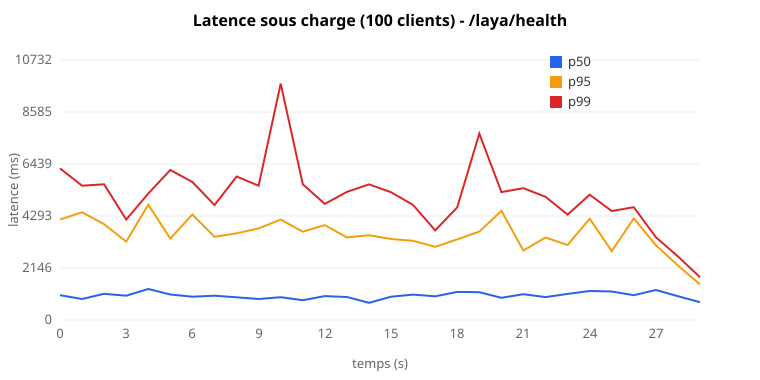
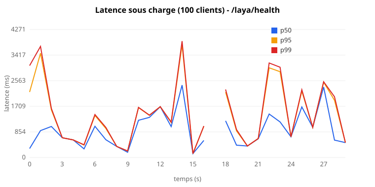
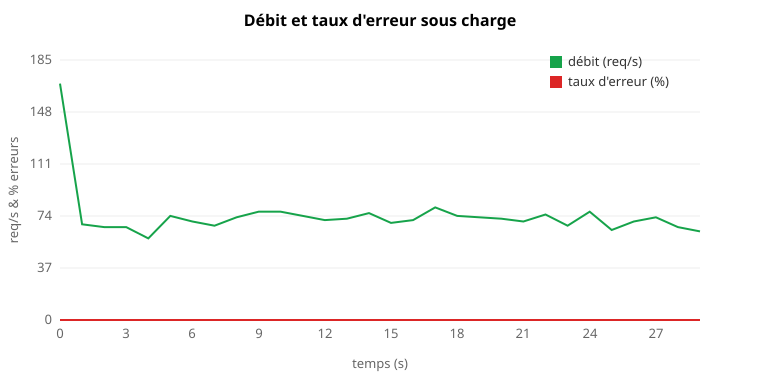
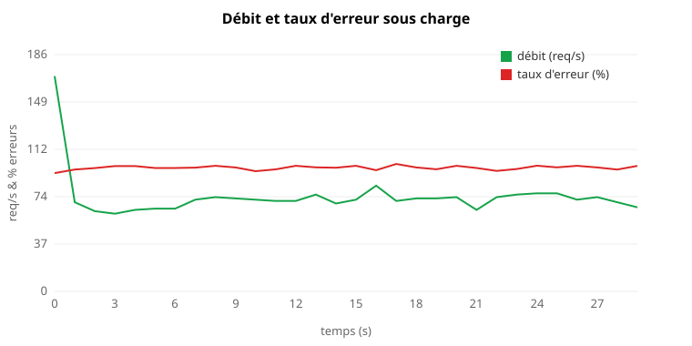
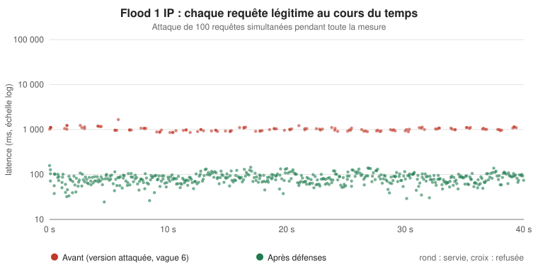

# Étape 2 — Mise en œuvre de l'attaque

## 0. Le script d'attaque

[attack/dos.py](../attack/dos.py) est un générateur de charge HTTP asynchrone (`httpx`) : N clients virtuels envoient des requêtes en continu pendant une durée fixe. Il mesure d'abord une **latence de référence** au repos (5 requêtes espacées), puis, seconde par seconde : latence p50/p95/p99, codes HTTP, disponibilité et débit. Garde-fous : durée bornée à 5 min, une seule cible, arrêt automatique. Endpoint, méthode et corps sont libres, pour viser l'API d'un autre groupe quel que soit son format.

```bash
uv run python attack/dos.py http://CIBLE --endpoint /laya/health --method GET --concurrency 100 --duration 30
```

Sorties dans [attack/results/](../attack/results/) : JSON complet, série temporelle CSV, graphiques SVG de latence et de débit, et un tableau de bord HTML de tous les tirs ([attack/report.py](../attack/report.py)).

Les trois métriques demandées par le sujet (précision, faux positifs, latence) ne se mesurent pas toutes depuis l'extérieur : sans clé d'API de la cible, on ne peut charger que ses endpoints publics, et on ne connaît pas la vérité terrain de ses réponses. Nous avons donc mené l'attaque à **deux endroits** :

| | Cible | Ce qu'on peut mesurer |
|---|---|---|
| §1 | API d'un autre groupe (« Dragons célestes »), sans clé | Latence, disponibilité, codes HTTP |
| §2 | **Notre propre API**, en local, version réellement attaquée en production (commit `451d731`) | Latence, disponibilité **et précision / faux positifs** sur des commentaires étiquetés |

## 1. Attaque contre l'API d'un autre groupe

**Cible :** `http://136.82.199.122/laya/health` (endpoint public ; `POST /laya/score`, qui exécute leur modèle, exige une clé que nous n'avions pas). **Protocole :** 3 paliers de 100, 1000 et 2000 clients simultanés, 30 s chacun, le 16/11 ; puis les mêmes paliers après leur correction. Analyse détaillée : [attack/analysis_vs_report_jungle.md](../attack/analysis_vs_report_jungle.md).

| Palier | Requêtes | Codes HTTP | Latence au repos | p50 | p95 | max |
|---|---|---|---|---|---|---|
| **Avant leur correction** | | | | | | |
| 100 clients | 2 221 | 100 % `200` | 58 ms | 989 ms | 3 757 ms | 11,7 s |
| 1000 clients | 2 553 | 100 % `200` | 51 ms | 9 825 ms | 39 452 ms | 43,7 s |
| 2000 clients | 3 379 | 100 % `200` | 48 ms | 29 861 ms | 51 951 ms | 56,2 s |
| **Après leur correction** | | | | | | |
| 100 clients | 2 231 | 3 % `200`, 97 % `429` | 48 ms | 651 ms | 3 130 ms | 3,9 s |
| 1000 clients | 2 492 | 4 % `200`, 96 % `429` | 49 ms | 5 752 ms | 36 623 ms | 42,2 s |
| 2000 clients | 3 390 | 3 % `200`, 97 % `429` | 47 ms | 15 186 ms | 46 292 ms | 53,3 s |

Graphiques produits par `dos.py` (latence p50/p95/p99 et débit seconde par seconde) :

| Palier 100 clients, avant leur correction | Palier 100 clients, après leur correction |
|---|---|
|  |  |
|  |  |

**Interprétation.**
- **Avant leur correction, leur API ne refusait jamais rien** : 100 % de `200`, mais un simple `GET /health` mettait jusqu'à 56 s à répondre. Toutes les requêtes s'empilent dans une file sans limite : le service n'est pas « en panne », il est inutilisable. C'est la signature d'une absence totale de délestage et de limitation de débit.
- **Après leur correction, 97 % des requêtes reçoivent `429`** : ils ont ajouté une limitation de débit, et notre attaque est désormais filtrée.
- **Limite de notre mesure.** Le débit plafonne entre 55 et 72 requêtes/s quel que soit le palier, avant comme après leur correction. Or nous avons mesuré en local que **notre propre client** `dos.py` (un seul processus Python) plafonne lui aussi vers 55 requêtes/s. Ce plafond, et une partie des latences aux paliers 1000 et 2000, viennent donc probablement de notre client et non de leur serveur. Les conclusions solides sont qualitatives (aucun rejet avant, 97 % de rejets après) ; les latences au-delà de 100 clients sont à prendre comme des ordres de grandeur. Le banc du §2 corrige ce défaut en répartissant l'attaque sur plusieurs processus.

## 2. Attaque contre notre modèle : précision, faux positifs, latence

**Script :** [attack/bench_defense.py](../attack/bench_defense.py). Il lance notre API **dans la version attaquée par le professeur** (commit `451d731`, extrait automatiquement de git), l'attaque, et fait tourner en parallèle 4 clients légitimes qui envoient de vrais commentaires du jeu de test Jigsaw dont on connaît l'étiquette.

| Paramètre | Valeur |
|---|---|
| Commentaires légitimes | 400 commentaires du jeu de test (200 toxiques, 200 non toxiques), tirage fixe (graine 42), ≤ 1500 caractères |
| Clients légitimes | 4 utilisateurs, 4 IP distinctes ; chacun envoie un commentaire, attend la réponse, pause 0,25 s |
| Attaque « flood 1 IP » | 1 IP, 100 requêtes simultanées en continu, texte de 1400 caractères (comme la vague 6) |
| Attaque « flood 25 IP » | 25 IP × 4 requêtes simultanées (attaque répartie) |
| Durée | 40 s de mesure par scénario, attaque lancée 3 s avant |
| Serveur | BERT sur CPU, 2 threads (comme un pod de 2 vCPU), une inférence à la fois |
| IP client | Transmise par l'en-tête `X-Forwarded-For`, comme derrière le load balancer Google |
| Décision | `is_toxic` renvoyé par l'API (probabilité de la classe `toxic` > 70 %) |

Résultats (version attaquée, données : [donnees/bench-avant.json](donnees/bench-avant.json)) :

| Clients légitimes | Sans attaque | Flood 1 IP | Flood 25 IP |
|---|---|---|---|
| Requêtes servies | 100 % | 100 % | 100 % |
| **Latence p50** | **39 ms** | **1 001 ms (×26)** | **2 029 ms (×52)** |
| Latence p95 | 78 ms | 1 185 ms | 2 282 ms |
| Commentaires analysés par seconde | 13,6 | 3,2 (÷4) | 1,8 (÷7,5) |
| **Précision** | **89,0 %** | 92,2 % | 95,0 % |
| **Taux de faux positifs** | **11,7 %** | 7,6 % | 5,9 % |
| Décisions identiques à celles sans attaque (mêmes textes) | — | **100 %** | **100 %** |
| Requêtes de l'attaquant atteignant le modèle | — | 100 % (2 138) | 100 % (2 354) |



**Interprétation.**
- **L'attaque vise la disponibilité, pas l'exactitude.** Pour un même texte, la décision du modèle est identique sous attaque et au repos (100 % des décisions comparées). Les écarts de précision et de faux positifs entre colonnes ne viennent que de l'échantillon : sous attaque, les clients n'ont le temps d'envoyer que 127 ou 73 commentaires au lieu de 543, ce qui donne un sous-ensemble plus petit et plus bruité. La précision et le taux de faux positifs de référence du modèle (89 % et 11,7 % sur cet échantillon équilibré, seuil 70) ne sont pas affectés par un DoS.
- **La latence est l'impact principal : ×26 avec une seule IP, ×52 avec 25 IP.** La version attaquée accepte tout et fait attendre : chaque requête légitime passe derrière toutes les requêtes de l'attaquant (100 % de ses requêtes atteignent le modèle). C'est exactement ce que le professeur a mesuré en production (×11).
- **La capacité de modération s'effondre.** Avec la même puissance de calcul, les utilisateurs légitimes ne font analyser que 3,2 puis 1,8 commentaires par seconde au lieu de 13,6. Pour une plateforme qui reçoit un flux constant de commentaires, la file de modération déborde : les clients finissent en timeout et, la modération étant « fail-open », **les commentaires toxiques sont publiés sans filtrage**. C'est l'impact éthique de la fiche d'attaque, mesuré.
- Le flood réparti sur 25 IP donne une latence deux fois plus élevée que le flood depuis 1 IP, à volume égal (100 requêtes simultanées). L'écart se reproduit sur deux passes, mais la version attaquée ne regarde pas l'IP : il ne vient donc pas de la répartition elle-même, et nous ne l'interprétons pas. Le scénario réparti sert surtout à l'étape 3, où les défenses, elles, s'appuient sur l'IP.

## 3. Attaques subies en production

| Date | Attaquant | Vue de l'attaquant | Vue côté serveur (nos logs) |
|---|---|---|---|
| 13/11 | Groupe « Report Jungle » | Jusqu'à 100 % d'échecs (`429`), rupture dès 20 requêtes simultanées | **0 erreur** sur 1189 requêtes reçues, p95 335 ms : les `429` venaient de Cloud Armor, avant nos pods ([attack/defense_analysis.md](../attack/defense_analysis.md)) |
| 17/11 | Professeur, vague 5 | Service instable (« flapping ») | Pods retirés du load balancer : sondes `/health` en échec sous charge (cause au §4) |
| 17/11 | Professeur, vague 6 | **7712 requêtes acceptées en 91,7 s, latence p50 1397 ms au lieu de 126 ms (×11)** ; modèle extractible à 489 requêtes/min ; en-têtes manquants ; `/model` trouvé via `/openapi.json` | Le ban par IP n'avait pas été appliqué sur le projet de production (simple limite de débit) ; la file d'attente faisait patienter jusqu'à 20 s au lieu de refuser ([attack/analysis_prof_attack.md](../attack/analysis_prof_attack.md)) |

La comparaison des deux attaques reçues est instructive : contre « Report Jungle », Cloud Armor a absorbé le choc **en amont** (l'attaquant a cru le service tombé, alors que le modèle n'a jamais été sollicité au-delà de sa capacité) ; contre le professeur, l'attaque est passée sous les seuils du load balancer et c'est **l'application elle-même** qui a cédé sur la latence. Il fallait donc des défenses aux deux niveaux : c'est l'objet de l'étape 3.

## 4. Zoom sur l'audit du professeur (vagues 5 et 6)

C'est l'attaque la plus instructive pour nous : la seule qui a atteint le modèle. Le professeur l'a menée avec ses propres outils contre notre API en production, puis nous a remis un audit de 4 constats. Nous avons vérifié chacun côté serveur :

| Constat de l'audit | Gravité | Ce que nous avons vérifié | Cause |
|---|---|---|---|
| DoS : 7712 requêtes **acceptées** en 92 s, latence ×11 | Haute | Confirmé, et reproduit en local (×26, §2) | Ban par IP jamais appliqué sur le projet de production (seule l'ancienne limite de 100 req/min/IP était active) ; file d'attente qui faisait patienter jusqu'à 20 s au lieu de refuser |
| Modèle extractible (489 req/min) | Moyenne | Confirmé | L'API renvoyait les 6 probabilités du modèle à chaque requête : de quoi entraîner une copie |
| `/model` découvert via `/openapi.json` ; en-têtes manquants | Moyenne | Docs publiques : confirmé. En-têtes : en partie inexact (HSTS et X-Content-Type-Options étaient présents, sans doute lus sur des réponses `429` de Cloud Armor) ; CSP et X-Frame-Options manquaient bien | Documentation activée par défaut ; en-têtes incomplets |
| Service instable (vague 5) | — | Confirmé | Endpoints synchrones : sous charge, les threads étaient tous bloqués dans la file et `/health` ne répondait plus, donc Kubernetes retirait le pod |

**Ce que l'audit nous a appris.** Notre défense reposait sur Cloud Armor ; elle a suffi contre un groupe qui attaquait depuis une IP au-dessus des seuils, pas contre une charge qui passait en dessous. L'API, elle, acceptait tout et faisait attendre tout le monde. Une défense écrite mais non déployée (le ban) ne protège pas. Les corrections qui en découlent, et leur effet mesuré, sont résumées dans [3_defense.md §1](3_defense.md) ; l'analyse complète est dans [attack/analysis_prof_attack.md](../attack/analysis_prof_attack.md).
