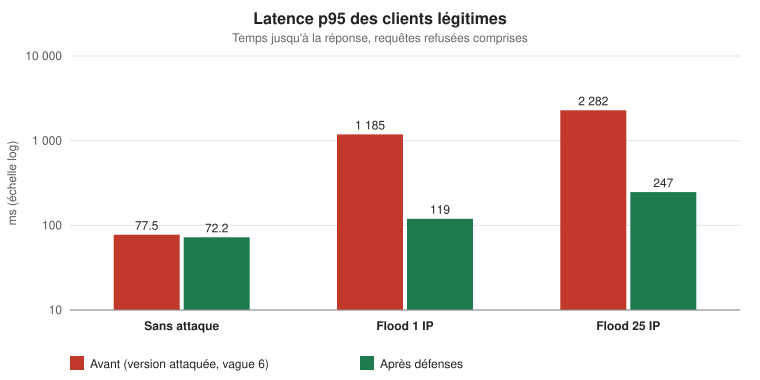
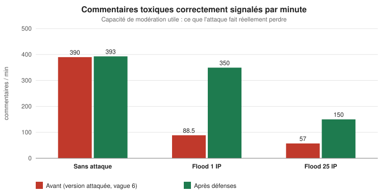
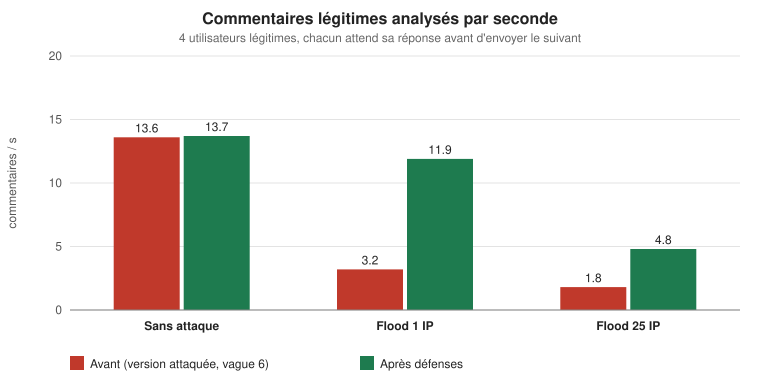
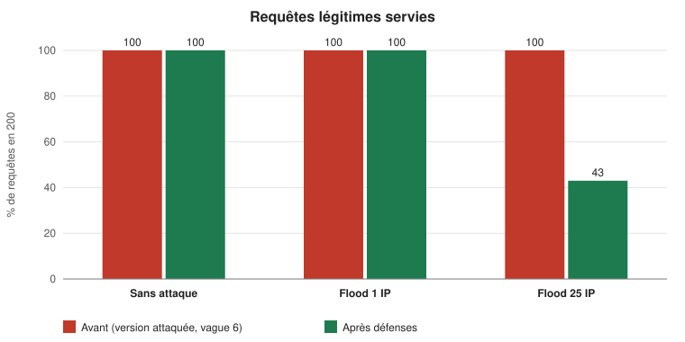
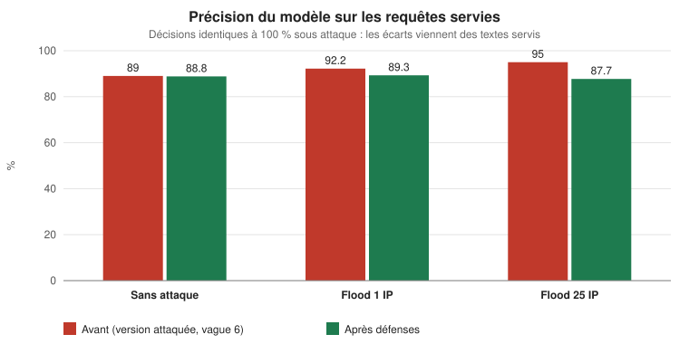
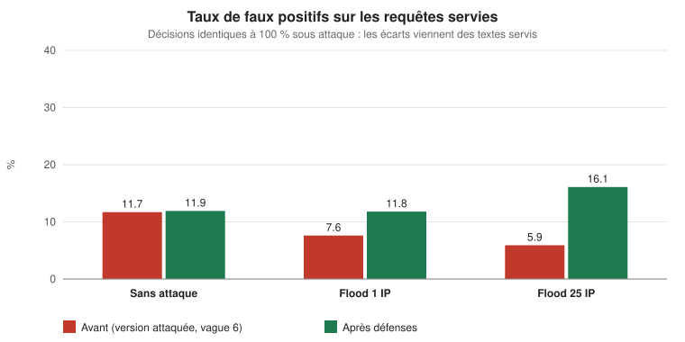
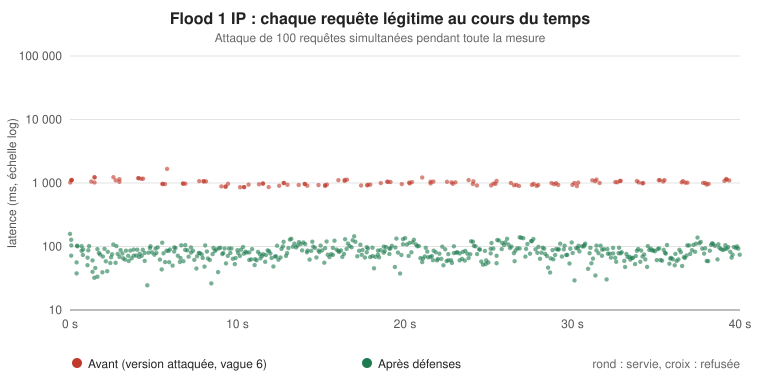

# Étape 3 — Conception d'une défense

## 1. Défenses implémentées

Chaque défense répond à un constat des attaques subies ([2_attaque.md §3](2_attaque.md)). Elles sont en couches : une requête doit les franchir dans l'ordre. Emplacement exact dans le code : [rendu.md](rendu.md) ; journal détaillé : [attack/defense_changes.md](../attack/defense_changes.md).

| # | Couche | Défense | Constat d'origine | Refus |
|---|---|---|---|---|
| 1 | Load balancer (Cloud Armor) | 100 req/min par IP, **ban de 10 min** au-delà de 200 req/min | Un simple throttle laisse l'attaquant revenir dès qu'il ralentit ; ban jamais appliqué en production (vague 6) | `429` |
| 2 | Load balancer (Cloud Armor) | Corps de plus de 4096 octets rejetés | Entrées surdimensionnées (« sponge input ») | `403` |
| 3 | API | **Plafond de 4 requêtes en cours par IP**, vérifié avant toute lecture | Une IP qui spamme monopolise le pod (vague 6) | `429` immédiat |
| 4 | API | Corps limité à 4096 octets (même sans `Content-Length`), texte à 1500 caractères | Le corps était lu et parsé en entier, même sans clé valide | `413`, `422` |
| 5 | API | **File d'attente bornée (8) et équitable** : file pleine, on éjecte une requête de l'IP la plus présente, pas le nouvel arrivant | Une file FIFO pleine refuse surtout les nouveaux clients, souvent légitimes | `503` |
| 6 | API | **Délestage rapide** : 2 s d'attente au plus (au lieu de 20 s) | Requêtes « acceptées mais lentes » : latence ×11 (vague 6) | `503` + `Retry-After` |
| 7 | API | Traitement asynchrone : une requête en attente n'occupe aucun thread, `/health` répond toujours | Sondes `/health` en échec sous charge, pods retirés du trafic (vague 5) | — |
| 8 | API | Réponse réduite à `{"is_toxic": …}` | Modèle extractible via les scores (489 req/min, vague 6) | — |
| 9 | API | `/docs` et `/openapi.json` fermés, en-têtes CSP, X-Frame-Options, Referrer-Policy | `/model` découvert via l'OpenAPI ; en-têtes manquants | `404` |
| 10 | Kubernetes | Autoscaling de 3 à 15 pods (cible 60 % CPU) | Capacité insuffisante sous charge durable | — |

Non retenu : un cache des réponses (inutile contre des textes variés, risque de servir une décision périmée) et un ban à durée progressive (non proposé par Cloud Armor).

### Récapitulatif : ce que l'audit du professeur a changé

La plupart de ces défenses (3 à 9) viennent de l'audit du professeur (vagues 5 et 6, détail en [2_attaque.md §4](2_attaque.md)). Chaque constat a donné lieu à une correction, vérifiée par une mesure ou par un test automatique de la CI :

| Constat de l'audit | Correction | Résultat |
|---|---|---|
| DoS : charge acceptée, latence ×11 | Ban Cloud Armor rendu déployable sur un projet neuf ; plafond de 4 requêtes en cours par IP ; délestage rapide (2 s au lieu de 20 s) ; file équitable | Latence médiane des clients légitimes sous flood : **1 001 → 81 ms** ; commentaires toxiques signalés : **88 → 350 par minute** (§3) |
| Service instable (vague 5) | Endpoints asynchrones | `/health` répond en quelques millisecondes sous charge, au lieu de 0,6 à 0,8 s |
| Modèle extractible | Réponse réduite à `{"is_toxic": …}` | Un bit d'information par requête au lieu de 6 probabilités (testé) |
| `/model` découvert via l'OpenAPI | Documentation fermée en production | `404` (testé) |
| En-têtes manquants | CSP, X-Frame-Options et Referrer-Policy ajoutés | Présents sur toutes les réponses, refus compris (testé) |

Le seul constat qui ne se vérifie pas en local est le ban Cloud Armor : il sera mesuré lors de la prochaine attaque en production (§6).

## 2. Protocole de comparaison

La même attaque est rejouée, avec le même script et les mêmes paramètres, contre :
- **Avant** : la version de l'API attaquée par le professeur (commit `451d731`, 16/11) ;
- **Après** : la version défendue (commit `68dadeb`, 17/11).

Banc : [attack/bench_defense.py](../attack/bench_defense.py), protocole détaillé dans [2_attaque.md §2](2_attaque.md) (400 commentaires étiquetés, 4 clients légitimes, flood depuis 1 IP puis depuis 25 IP, 40 s de mesure par scénario). Le banc teste la **couche applicative seule** (défenses 3 à 9) : Cloud Armor et l'autoscaling n'existent qu'en production.

```bash
uv run python attack/bench_defense.py run --ref 451d731 --label avant
uv run python attack/bench_defense.py run --label apres
uv run python attack/bench_defense.py report
```

## 3. Tableau des métriques avant / après

Vu par les **clients légitimes** pendant l'attaque. Tableau complet (codes HTTP, rappel, attaquant) : [donnees/tableau_avant_apres.md](donnees/tableau_avant_apres.md) ; données brutes : [donnees/](donnees/).

| Indicateur | Sans attaque<br>avant → après | Flood 1 IP<br>avant → après | Flood 25 IP<br>avant → après |
|---|---|---|---|
| **Latence p50** | 39 → 37 ms | **1 001 → 81 ms** | **2 029 → 223 ms** |
| Latence p95 (refus compris) | 78 → 72 ms | 1 185 → 119 ms | 2 282 → 247 ms |
| Requêtes légitimes servies | 100 → 100 % | 100 → 100 % | 100 → **43 %** |
| Commentaires analysés par seconde | 13,6 → 13,7 | 3,2 → **11,9** | 1,8 → **4,8** |
| Toxiques correctement signalés par minute | 390 → 393 | 88 → **350** | 57 → **150** |
| **Précision** (requêtes servies) | 89,0 → 88,8 % | 92,2 → 89,3 % | 95,0 → 87,7 % |
| **Taux de faux positifs** (requêtes servies) | 11,7 → 11,9 % | 7,6 → 11,8 % | 5,9 → 16,1 % |
| Décisions identiques à celles sans attaque | 100 % | 100 → 100 % | 100 → 100 % |
| Requêtes de l'attaquant atteignant le modèle | — | 100 → 73 % | 100 → 39 % |

**Précision et faux positifs de référence du modèle** (sur les 400 textes distincts, seuil 70, identiques pour les deux versions) : précision **88,1 %**, taux de faux positifs **13,0 %**, rappel **96,5 %**. Les variations d'une colonne à l'autre du tableau ne sont **pas** des changements du modèle : sous attaque, chaque décision est identique à 100 % à celle obtenue sans attaque ; seul change l'ensemble des textes qui ont eu le temps d'être analysés (127 ou 73 textes au lieu de 400 avant défense).

## 4. Graphiques de comparaison

| | |
|---|---|
|  |  |
|  |  |
|  |  |



## 5. Interprétation

**Sans attaque, les défenses ne coûtent rien** : même latence (37 ms contre 39), même débit, mêmes décisions. Aucun client légitime n'est refusé.

**Flood depuis une IP (le cas de la vague 6) : la défense fonctionne.**
- La latence médiane des clients légitimes passe de **1 001 ms à 81 ms** (÷12), sans aucun refus.
- Ils retrouvent **87 % de leur débit normal** (11,9 commentaires/s contre 13,7 sans attaque), contre 23 % avant.
- 350 commentaires toxiques signalés par minute au lieu de 88 : la modération continue de fonctionner pendant l'attaque.
- Mécanisme : l'attaquant ne peut plus avoir que 4 requêtes en cours ; ses autres requêtes sont refusées en `429` avant d'avoir coûté quoi que ce soit, et ne prennent plus de place dans la file devant les clients légitimes.
- En production, Cloud Armor ajoute une barrière que le banc ne simule pas : au-delà de 200 requêtes par minute, cette IP serait bannie pendant 10 minutes.

**Flood réparti sur 25 IP : la défense limite les dégâts, sans les supprimer.**
- Chaque IP attaquante reste sous le plafond de 4 requêtes : le filtre par IP ne la voit pas. La file équitable traite alors chaque IP à parts égales ; les 4 clients légitimes représentent 4 IP sur 29, et obtiennent 11 % des inférences, proche de cette part équitable (14 %).
- Résultat : **57 % des requêtes légitimes sont refusées** (`503`), mais en quelques millisecondes ; celles qui passent sont servies en 223 ms au lieu de 2 s.
- En volume, la version défendue fait mieux que la version attaquée : **4,8 commentaires analysés par seconde contre 1,8**, et 150 toxiques signalés par minute contre 57. La version attaquée « servait » 100 % des requêtes, mais si lentement que les clients n'en envoyaient presque plus.
- C'est la **limite des défenses par IP** : contre une attaque largement distribuée, seule la capacité (plus de pods, prêts plus tôt) ou une identification par client (une clé par client) permet de protéger les utilisateurs légitimes. Voir [6_analyse_critique.md](6_analyse_critique.md).

**Sur la qualité du modèle** : ni l'attaque ni la défense ne changent les décisions (100 % identiques). L'exactitude n'est pas la cible d'un DoS ; ce qui est en jeu, c'est le nombre de textes réellement modérés, mesuré ci-dessus en commentaires toxiques signalés par minute.

## 6. Validation en production (à compléter après la prochaine attaque)

La mesure locale doit être confirmée sur l'API déployée, avec les logs du load balancer activés le temps du test (procédure : [attack/defense_changes.md §7](../attack/defense_changes.md)).

| Métrique | Vague 6, avant défenses (17/11) | Prochaine attaque, après défenses |
|---|---|---|
| Requêtes de l'attaquant acceptées | 7 712 en 91,7 s | _à mesurer_ |
| Latence p50 vue par l'attaquant | 1 397 ms (126 ms au repos) | _à mesurer_ |
| Extraction du modèle | 489 requêtes/min, scores renvoyés | _à mesurer_ (décision seule renvoyée) |
| IP de l'attaquant bannie par Cloud Armor | non (ban non déployé) | _à vérifier dans les logs du load balancer_ |
| Refus `429` / `503` côté API (`toxic_api_shed_total`) | aucun refus | _à mesurer_ |
| `/docs`, `/openapi.json` | exposés | `404` (vérifié en local et par les tests) |
